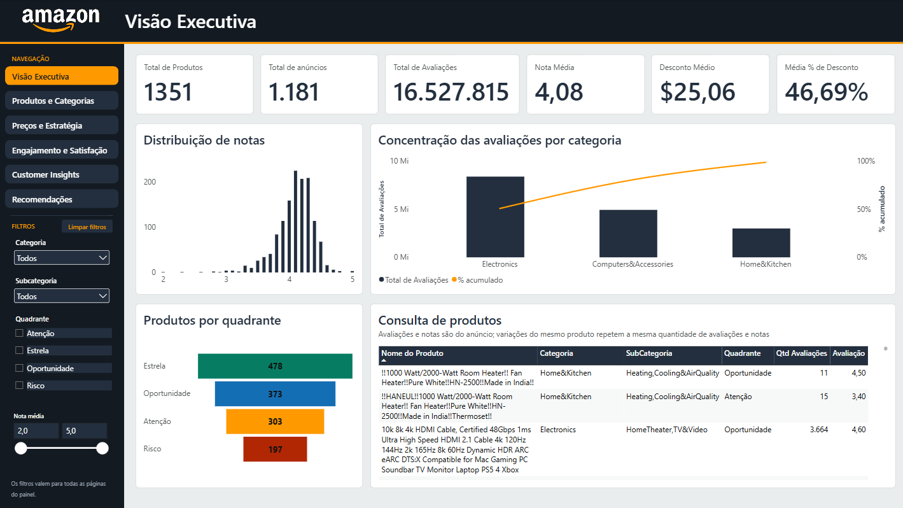
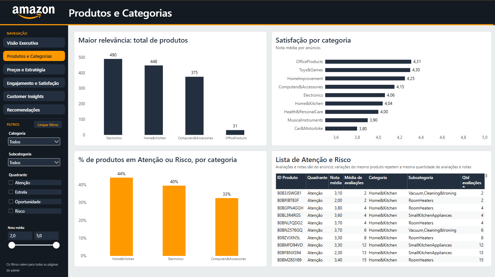
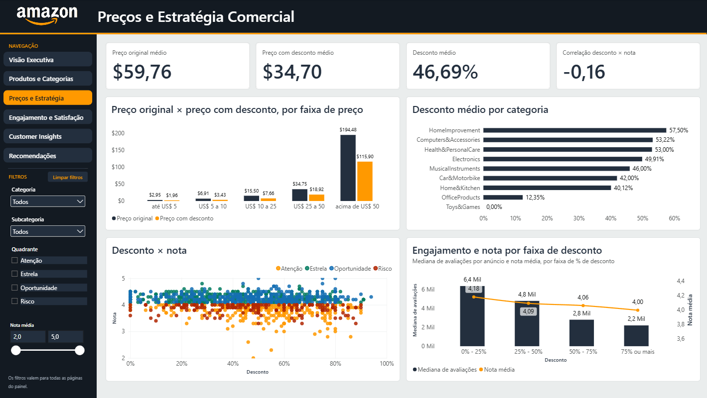
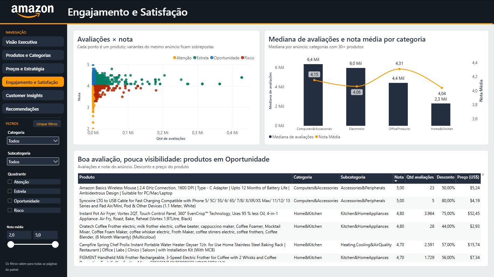
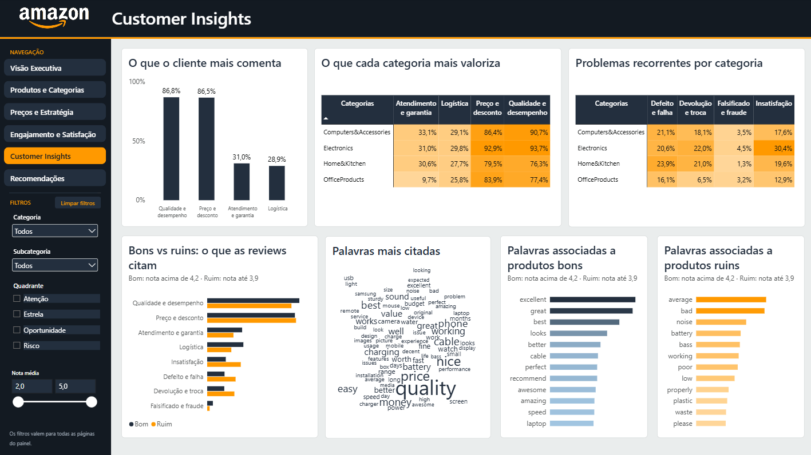
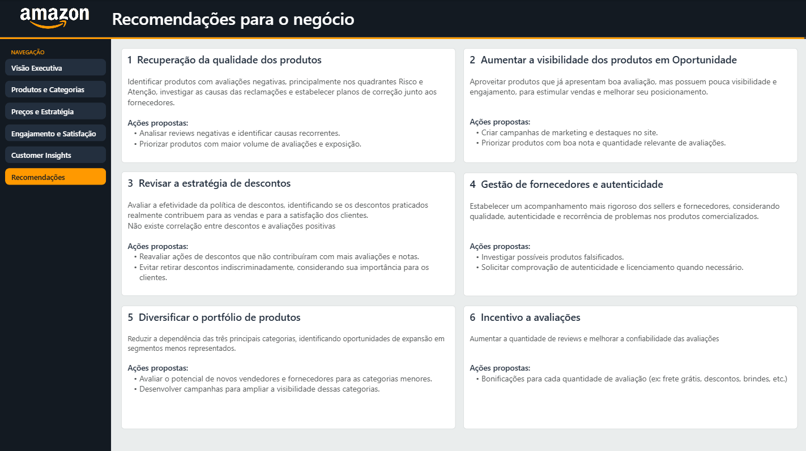
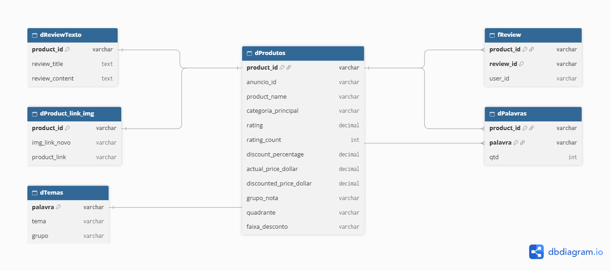

# Amazon Product Performance & Customer Insights

Dashboard em Power BI que analisa o portfólio de produtos de um marketplace (Amazon Índia) e a percepção dos clientes, relacionando **preço → desconto → engajamento → satisfação**.

Projeto do **Tech Challenge – Fase 4** da pós-graduação POSTECH Data Analytics (DTAT), desenvolvido pelo **Grupo 22**.

## Acesse

- **Vídeo da apresentação executiva:** [assistir no YouTube](https://youtu.be/JaqqyFAjEPw)
- **Dashboard publicado** (para consultar de imediato, sem instalar nada): [abrir o dashboard](https://tinyurl.com/mrtptnpt)
- **Arquivo do dashboard (`.pbix`):** em [`dashboard/`](dashboard/)

## Pergunta de negócio

> Quais produtos, categorias e estratégias comerciais merecem maior atenção e quais oportunidades podem ser identificadas a partir dos dados disponíveis?

## Equipe (Grupo 22)

| Integrante | GitHub |
|---|---|
| Carlos Henrique Freitas | [@Finnagun](https://github.com/Finnagun) |
| Maycon Suel da Silva Nunes | [@MayconNune](https://github.com/MayconNune) |
| Vinicius Lopes Romão | [@viniromao159](https://github.com/viniromao159) |

## Dados

- **Fonte:** [Amazon Sales Dataset (Kaggle)](https://www.kaggle.com/datasets/karkavelrajaj/amazon-sales-dataset).
- **Tamanho:** 1.465 linhas e 16 colunas, que viram **1.351 produtos** depois da limpeza. Cada variante (cor, tamanho) conta como um produto.
- **Anúncios:** as variantes que compartilham as mesmas reviews formam **1.181 anúncios**. Avaliações, nota e engajamento são contados uma vez por anúncio; preço, desconto e contagem de produtos, por produto (veja [`docs/decisoes-de-dados.md`](docs/decisoes-de-dados.md), seção 7).
- **Reviews:** 10.605 reviews em texto (9.269 distintas), uma **amostra** de cerca de 8 por produto. O total de avaliações dos anúncios é de **16,5 milhões**.
- **Categorias:** 9 categorias principais; Electronics, Home&Kitchen e Computers&Accessories concentram 97% dos produtos.
- **Moeda:** os preços originais estão em rupias (₹) e foram convertidos para US$ à taxa de 0,0105 por ₹ (cotação de 08/10/2026).

## O dashboard

O dashboard está [publicado online](https://tinyurl.com/mrtptnpt) para consulta imediata, e o arquivo `.pbix` também está em [`dashboard/`](dashboard/). As seis páginas seguem a estrutura sugerida no desafio:

| Página | O que responde |
|---|---|
| **Visão Executiva** | KPIs (produtos, anúncios, avaliações, nota, desconto), distribuição de notas, concentração das avaliações por categoria, produtos por quadrante e consulta de produtos |
| **Produtos e Categorias** | Relevância e satisfação por categoria, % de produtos em Atenção ou Risco e lista dos produtos que merecem ação |
| **Preços e Estratégia** | Preço original × preço com desconto, desconto por categoria, relação desconto × nota e engajamento por faixa de desconto |
| **Engajamento e Satisfação** | Avaliações × nota (por quadrante), mediana de avaliações por categoria e produtos com boa nota e pouca visibilidade |
| **Customer Insights** | O que os clientes comentam, problemas recorrentes por categoria, produtos bons vs ruins e nuvem de palavras |
| **Recomendações** | Seis ações para o negócio, ligadas aos achados |













## Vídeo executivo

Apresentação para a liderança com o contexto, os indicadores, os insights, a demonstração do dashboard, os Customer Insights, as recomendações e as mensagens finais.

[](https://youtu.be/JaqqyFAjEPw)

## Principais insights

1. **O portfólio é concentrado.** Electronics (50,6%), Computers&Accessories (29,7%) e Home&Kitchen (18,1%) reúnem 98% das avaliações. As notas ficam entre 3,9 e 4,4 em 76% dos produtos, com pico em 4,1, e a nota média é de 4,08 por anúncio.
2. **O desconto é alto e não traz engajamento.** O desconto médio é de US$ 25,06, ou 46,7% sobre o preço de tabela. A correlação entre desconto e nota é fraca e negativa (−0,16), e a mediana de avaliações por anúncio cai de 6,4 mil (descontos até 25%) para 2,2 mil (acima de 75%). É uma associação, não uma causa.
3. **37% dos produtos pedem ação.** Pelos quadrantes, 35% dos produtos são Estrela, 28% Oportunidade, 22% Atenção e 15% Risco: 500 produtos em Atenção ou Risco. Home&Kitchen é a categoria mais exposta (cerca de 44% dos seus produtos nesses quadrantes), seguida de Electronics (40%).
4. **Há produtos bons que ninguém vê.** Os 373 produtos em Oportunidade têm boa nota e pouca visibilidade, e são os candidatos a ganhar destaque.
5. **Os clientes comentam qualidade e preço.** Os dois temas aparecem em cerca de 87% dos produtos, contra 31% de atendimento e 29% de logística.
6. **Produtos bons e ruins se separam por problemas e pós-venda, não por preço.** Os ruins citam mais insatisfação (32% contra 18%), defeito e falha (27% contra 17%) e devolução e troca (26% contra 17%). Os bons citam mais logística e atendimento.

Os números vêm de uma amostra de reviews e a análise de texto é por palavras-chave, sem considerar negação; as relações encontradas são associações.

## Recomendações

| # | Recomendação | Ações |
|---|---|---|
| 1 | **Recuperar a qualidade dos produtos**, principalmente nos quadrantes Risco e Atenção | Analisar as reviews negativas, identificar causas recorrentes e priorizar os produtos de maior volume, com plano de correção junto aos fornecedores |
| 2 | **Aumentar a visibilidade dos produtos em Oportunidade** | Campanhas de marketing e destaques no site para produtos com boa nota |
| 3 | **Revisar a estratégia de descontos**, já que há apenas correlação fraca e negativa entre desconto e nota | Reavaliar as ações que não contribuem com avaliações e notas, sem retirar descontos indiscriminadamente |
| 4 | **Gestão de fornecedores e autenticidade** | Acompanhamento mais rigoroso de sellers e fornecedores, investigação de possíveis produtos falsificados e comprovação de autenticidade quando necessário |
| 5 | **Diversificar o portfólio** | Reduzir a dependência das três categorias principais, avaliando novos vendedores e campanhas para as categorias menores |
| 6 | **Estimular avaliações** | Lembretes pós-compra e incentivos independentes da nota, respeitando as regras do marketplace |

## Modelo de dados



Detalhes, granularidade de cada tabela e justificativa em [`docs/modelo-e-metodologia.md`](docs/modelo-e-metodologia.md).

## Como reproduzir

Para só consultar, use o [dashboard publicado](https://tinyurl.com/mrtptnpt). Para reproduzir o modelo no seu computador:

1. Baixe o `amazon.csv` no Kaggle e salve em `data/raw/`.
2. Abra o `.pbix` de `dashboard/` no **Power BI Desktop** (Windows).
3. Em **Transformar dados → Gerenciar parâmetros**, ajuste `CaminhoCSV` para o local do seu `amazon.csv` e clique em **Fechar e aplicar**.
4. As consultas do Power Query e as medidas DAX estão em [`powerquery/`](powerquery/) e [`dax/`](dax/), caso queira recriar o modelo do zero.

Todo o tratamento dos dados (limpeza, conversão de moeda, correção dos links e agrupamento de variantes) acontece dentro do Power BI.

## Estrutura do repositório

```
.
├── README.md
├── dashboard/            # arquivo .pbix e prints das páginas (img/)
├── data/
│   └── raw/              # amazon.csv (não versionado; ver README da pasta)
├── docs/
│   ├── decisoes-de-dados.md        # limpeza e tratamento, com os números
│   ├── modelo-e-metodologia.md     # modelo, análise de texto e segmentações
│   ├── modelo-de-dados.dbml        # código do diagrama (dbdiagram.io)
│   └── img/                        # diagrama do modelo
├── powerquery/           # código M de cada consulta e dos parâmetros
└── dax/                  # medidas e colunas calculadas
```

## Limitações

- As reviews em texto são uma amostra; os resultados da análise de texto valem para essa amostra.
- Os temas são definidos por listas de palavras e a análise **não considera negação**. A análise de texto é por produto, e variantes do mesmo anúncio repetem as reviews (cerca de 16% das menções; efeito de até 1,4 ponto percentual nos percentuais).
- Os comparativos por categoria usam só categorias com 30+ produtos; alguns gráficos mostram as nove categorias, e as de 1 ou 2 produtos devem ser lidas com cuidado.
- Os quadrantes usam a mediana por produto, e os gráficos de engajamento, a mediana por anúncio.
- As relações encontradas são **associações**, não causas.

## Créditos

Dataset: [karkavelrajaj/amazon-sales-dataset](https://www.kaggle.com/datasets/karkavelrajaj/amazon-sales-dataset) (Kaggle). Confira a licença na página do dataset antes de redistribuí-lo.
