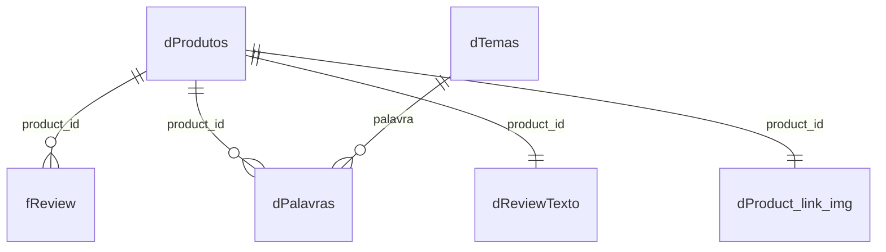

# Amazon Product Performance & Customer Insights

Dashboard em Power BI que analisa o portfólio de produtos de um marketplace (Amazon Índia) e a percepção dos clientes, relacionando **preço → desconto → engajamento → satisfação**.

Projeto do **Tech Challenge – Fase 4** da pós-graduação POSTECH Data Analytics (DTAT), desenvolvido pelo **Grupo 22**.

## Pergunta de negócio

> Quais produtos, categorias e estratégias comerciais merecem maior atenção e quais oportunidades podem ser identificadas a partir dos dados disponíveis?

## Equipe (Grupo 22)

| Integrante | GitHub |
|---|---|
| Carlos Henrique Freitas | [@Finnagun](https://github.com/Finnagun) |
| Maycon Suel da Silva Nunes | [@MayconNune](https://github.com/MayconNune) |
| Vinicius Lopes Romão | [@viniromao159](https://github.com/viniromao159) |

## Dados

- **Fonte:** [Amazon Sales Dataset (Kaggle)](https://www.kaggle.com/datasets/karkavelrajaj/amazon-sales-dataset).
- **Tamanho:** 1.465 linhas e 16 colunas, que viram **1.351 produtos únicos** depois da limpeza.
- **Reviews:** 10.605 reviews em texto, uma **amostra** de cerca de 8 por produto (o total de avaliações dos produtos é de dezenas de milhões).
- **Categorias:** 9 categorias principais; Electronics, Home&Kitchen e Computers&Accessories concentram 97% dos produtos.
- Os preços originais estão em rupias indianas (₹). Veja as decisões de tratamento em [`docs/decisoes-de-dados.md`](docs/decisoes-de-dados.md).

## O dashboard

| Página | O que responde |
|---|---|
| **Portfólio** | KPIs, distribuição de notas, concentração de avaliações por categoria (Pareto), produtos por quadrante (Estrela, Oportunidade, Atenção, Risco) e tabela de consulta com filtros e imagem do produto |
| **Engajamento e satisfação** | Engajamento (mediana de avaliações) e nota por faixa de desconto e por categoria; palavras mais associadas a produtos bons e ruins |
| **Atenção e Risco** | Produtos com nota baixa (até 4,0): categorias, subcategorias e lista dos produtos mais expostos |
| **Customer Insights** | O que os clientes comentam (logística, preço, qualidade, atendimento), problemas recorrentes por categoria, produtos bons vs ruins e nuvem de palavras |

<!-- Substituir pelos prints finais em dashboard/img/ -->
<!--  -->
<!--  -->
<!--  -->
<!--  -->

## Principais achados

- **O portfólio é concentrado:** Electronics, Computers&Accessories e Home&Kitchen somam 98,9% das avaliações (Electronics sozinha, 59,7%).
- **As notas se agrupam em torno de 4,1:** cerca de 74% dos produtos têm nota entre 3,8 e 4,3.
- **Desconto alto anda junto com menos engajamento:** a mediana de avaliações cai de 7,2 mil (até 25% de desconto) para 3,0 mil (50% a 75%), e a nota média vai de 4,17 para 4,00. É uma associação, não uma causa.
- **As reviews falam de qualidade e preço** (citados em cerca de 87% dos produtos), bem mais do que de logística (29%) e atendimento (31%).
- **Produtos bons e ruins se separam por problemas e pós-venda, não por preço:** os ruins citam mais insatisfação (32,4% contra 17,9%), defeito e falha (27,4% contra 16,7%) e devolução e troca (26,2% contra 16,5%); os bons citam mais logística (34,8% contra 23,2%) e atendimento (33,7% contra 25,3%).
- **Cerca de 37% do portfólio (500 produtos) está em Atenção ou Risco.** Electronics concentra o Risco, e Home&Kitchen concentra a Atenção.

## Recomendações

> _A completar pelo grupo._

## Modelo de dados



Detalhes, granularidade de cada tabela e justificativa em [`docs/modelo-e-metodologia.md`](docs/modelo-e-metodologia.md).

## Como reproduzir

1. Baixe o `amazon.csv` no Kaggle e salve em `data/raw/`.
2. Abra o arquivo `.pbix` de `dashboard/` no **Power BI Desktop** (Windows).
3. Em **Transformar dados → Configurações da fonte de dados**, aponte para o seu `amazon.csv` e clique em **Atualizar**.
4. As consultas do Power Query e as medidas DAX estão em `powerquery/` e `dax/`, caso queira recriar o modelo do zero.

Para gerar o arquivo de links corrigidos fora do Power BI:

```bash
pip install -r requirements.txt
python scripts/corrige_links.py data/raw/amazon.csv data/processed/links_corrigidos.csv
```

## Estrutura do repositório

```
.
├── README.md
├── dashboard/            # arquivo .pbix e prints das páginas (img/)
├── data/
│   ├── raw/              # amazon.csv (não versionado; ver README da pasta)
│   └── processed/        # links_corrigidos.csv
├── docs/
│   ├── decisoes-de-dados.md        # limpeza e tratamento, com os números
│   └── modelo-e-metodologia.md     # modelo, análise de texto e segmentações
├── powerquery/           # código M de cada consulta
├── dax/                  # medidas e colunas calculadas
├── scripts/              # corrige_links.py
└── requirements.txt
```

## Limitações

- As reviews em texto são uma amostra; os resultados da análise de texto valem para essa amostra.
- Os temas são definidos por listas de palavras e a análise **não considera negação**.
- Os comparativos por categoria usam só categorias com 30+ produtos.
- O total de avaliações soma variantes do mesmo anúncio (ver `docs/decisoes-de-dados.md`).
- As relações encontradas são **associações**, não causas.

## Créditos

Dataset: [karkavelrajaj/amazon-sales-dataset](https://www.kaggle.com/datasets/karkavelrajaj/amazon-sales-dataset) (Kaggle).
