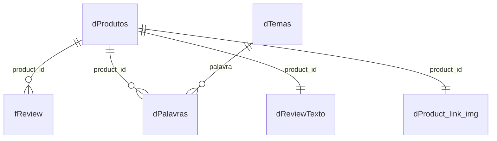

# Modelo de dados e metodologia de análise

## 1. Modelo de dados

| Tabela | Uma linha representa | Linhas |
|---|---|---|
| `dProdutos` | um produto | 1.351 |
| `fReview` | uma review de um produto | 10.605 |
| `dReviewTexto` | o texto concatenado das reviews de um produto | 1.351 |
| `dProduct_link_img` | os links (imagem e produto) de um produto | 1.351 |
| `dPalavras` | uma palavra em um produto (com a quantidade de menções) | ~120 mil |
| `dTemas` | uma palavra-chave de um tema | 81 |
| `dStopwords` | uma palavra ignorada (só apoio, não carregada) | 148 |

### Por que tudo se liga à `dProdutos`, e não à `fReview`

A regra de ligar as dimensões à fato depende do **nível de detalhe** de cada tabela. Só a `fReview` está no nível de review; as demais estão no nível de produto (ou produto e palavra), e o ponto em comum entre elas é o produto.

- Ligar `dPalavras` à `fReview` seria muitos para muitos (`product_id` se repete nas duas) e inflaria as contagens, o mesmo efeito do produto cartesiano que evitamos na explosão das reviews.
- Ligar as tabelas 1:1 às duas fatos criaria dois caminhos entre as mesmas tabelas.
- Com a `dProdutos` como dimensão compartilhada, uma segmentação de categoria ou de nota filtra `fReview` e `dPalavras` ao mesmo tempo.

Limite conhecido: o filtro vai da `dProdutos` para as fatos, então um tema selecionado não filtra a `fReview`. Dá para contar **produtos** que citam o tema, mas não **reviews** que o citam.

## 2. Análise de texto (Customer Insights)

### Pipeline (`powerquery/dPalavras.pq`)

1. Junta `review_title` e `review_content` por produto (`dReviewTexto`, em minúsculas).
2. Separa em palavras por pontuação e símbolos, mantém só letras de a a z (descarta hindi, emoji e números) e palavras com 3 ou mais letras.
3. Remove as stopwords (`dStopwords`): palavras funcionais do inglês, hindi romanizado e termos sem informação como `product` e `good`.
4. Conta as menções por produto e palavra.

### Temas (`powerquery/dTemas.pq`)

| Grupo | Tema | Palavras |
|---|---|---|
| Valor percebido | Logística | 12 |
| Valor percebido | Preço e desconto | 14 |
| Valor percebido | Qualidade e desempenho | 11 |
| Valor percebido | Atendimento e garantia | 7 |
| Problema | Defeito e falha | 13 |
| Problema | Devolução e troca | 8 |
| Problema | Falsificado e fraude | 6 |
| Problema | Insatisfação | 10 |

**Palavras deixadas de fora de propósito**, por serem ambíguas:

- `issue`, `problem` (aparecem muito em "no issue" e "no problem") e `bad` (em "not bad");
- `cheap` (preço baixo e qualidade ruim) e `service` ("service center");
- `money` (quase sempre em "value for money", o que contaria o mesmo elogio duas vezes junto com `value`);
- Superaquecimento como tema: em Home&Kitchen, `heating` quase sempre é a **função** do produto (chaleira, aquecedor), e as palavras que só indicam problema (`overheating`, `overheated`) somam menos de 5 ocorrências.

### Métricas

- **% de produtos que mencionam o tema** (principal): vai de 0% a 100% e não é inflada por produtos que repetem a palavra.
- **Menções por produto:** média de ocorrências por produto; pode passar de 1 e é sensível a repetições.
- Para engajamento, usa-se a **mediana** de avaliações, não a média, porque a distribuição tem cauda muito longa (poucos produtos com centenas de milhares de avaliações).

### Limitações

- A contagem é por palavra e **não entende negação**: "not working" conta como `working`.
- Os temas têm listas de tamanhos diferentes, e um tema com mais palavras tende a ter mais menções.
- Mencionar um tema não significa valorizá-lo.
- A base tem cerca de 8 reviews por produto (amostra); as diferenças entre grupos são **associações**, não causas.

## 3. Segmentações analíticas

### Grupo de nota (`grupo_nota`)

| Grupo | Regra | Produtos |
|---|---|---|
| Ruim | nota até 3,9 | 340 |
| Intermediário | entre 3,9 e 4,2 | 591 |
| Bom | nota acima de 4,2 | 419 |
| (em branco) | produto sem nota válida | 1 |

### Faixas de desconto

`0% a 25%`, `25% a 50%`, `50% a 75%` e `75% ou mais`, sobre `discount_percentage` (o limite inferior de cada faixa é incluído).

### Quadrantes (Estrela, Oportunidade, Atenção, Risco)

Coluna calculada `quadrante` (`dax/medidas.dax`). Cada eixo é dividido pela **mediana** do portfólio: nota 4,1 e `rating_count` 4.740. Valores iguais à mediana ficam no lado "alto".

| | Nota maior ou igual a 4,1 | Nota abaixo de 4,1 |
|---|---|---|
| **Engajamento alto** (≥ 4.740) | Estrela (478) | Risco (197) |
| **Engajamento baixo** (< 4.740) | Oportunidade (373) | Atenção (303) |

**Valores em branco** são tratados como zero pelo DAX e caem no lado "baixo": o produto sem nota válida (`B08L12N5H1`) e o produto sem `rating_count` e com nota 3,0 (`B0B94JPY2N`) entram em Atenção, e o sem `rating_count` e com nota 5,0 (`B0BQRJ3C47`) entra em Oportunidade.

## 4. Ressalvas gerais para a leitura do dashboard

- O total de avaliações soma variantes do mesmo anúncio (ver `decisoes-de-dados.md`, seção 8).
- Os comparativos por categoria usam só as 4 categorias com 30+ produtos; OfficeProducts tem 31.
- Os produtos "ruins" se concentram em Electronics e Home&Kitchen, então palavras como `battery` ou `bass` refletem a categoria tanto quanto a qualidade.
